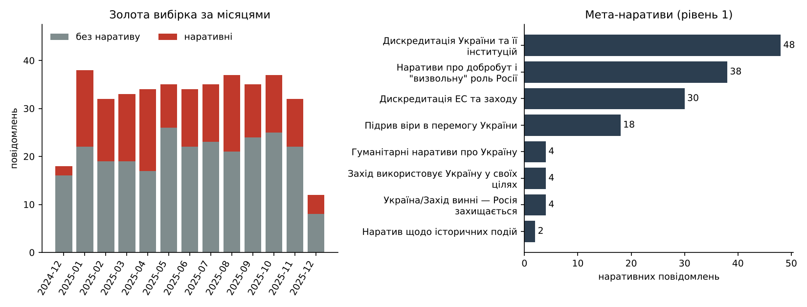

# Етап S0. Аудит даних TeleNarratives

Усі числа перераховані скриптом `scripts/s00_audit.py`, результати в `results/00_audit/`.
Джерело: клон https://github.com/yuliavistak/TeleNarratives (MIT).

## 1. Золота вибірка

| Показник | Значення |
|---|---|
| Повідомлень | 412 |
| Наративних (Binary label = True) | 148 (35,9%) |
| Каналів у вибірці | 56 з 98 |
| Частка форвардів | 9,0% |
| Період | 2024-12-17 - 2025-12-11 (13 міс.) |
| Повідомлень на місяць, повні місяці (мін / медіана / макс) | 32 / 35,0 / 38 |
| Неповні крайні місяці (перший / останній) | 18 / 12 |
| Довжина тексту, символів (медіана / середня / 90-й перцентиль) | 265 / 398 / 813 |
| Частка найбільшого каналу / п'яти найбільших | 9,0% / 34,2% |
| Каналів з 5 і більше повідомленнями | 24 |

Розподіл мета-наративів серед наративних повідомлень:

| Мета-наратив (рівень 1) | Повідомлень | Частка |
|---|---|---|
| Дискредитація України та її інституцій | 48 | 32,4% |
| Наративи про добробут і "визвольну" роль Росії | 38 | 25,7% |
| Дискредитація ЕС та заходу | 30 | 20,3% |
| Підрив віри в перемогу України | 18 | 12,2% |
| Захід використовує Україну у своїх цілях | 4 | 2,7% |
| Гуманітарні наративи про Україну | 4 | 2,7% |
| Україна/Захід винні — Росія захищається | 4 | 2,7% |
| Наратив щодо історичних подій | 2 | 1,4% |

Висновок для оцінки: багатокласові метрики мають сенс лише для чотирьох найбільших класів, решта класів замалі. Основна
оцінка бінарна. Концентрація по каналах помітна (таблиця вище), тому окрім звичайної крос-валідації потрібна CV за каналами.

## 2. Міжанотаторська згода (спільна підвибірка)

| Випадок | Об'єктів | κ Фляйса (перераховано) | κ Фляйса (у файлі) | |Δ| |
|---|---|---|---|---|
| binary | 103 | 0,8871 | 0,8871 | 0,0000 |
| multiclass | 103 | 0,6257 | 0,6257 | 0,0000 |
| multiclass_level_1 | 103 | 0,7182 | 0,7182 | 0,0000 |

Перерахунок за колонками рецензентів збігається з файлом авторів. У файлі колонка третього рецензента на рівні level-1
названа `Reviewer 2 (level-1).1`, у конфігу це враховано.

## 3. Результати оригінальних моделей

| Модель | n (test) | F1 у файлі (general_f1) | accuracy (перераховано) | macro-F1 (перераховано) | F1 класу «наратив» | MCC | PR-AUC | ROC-AUC |
|---|---|---|---|---|---|---|---|---|
| GNN: posted + forwards | 8 142 | 0,789 | 0,789 | 0,777 | 0,726 | 0,565 | 0,800 | 0,876 |
| GNN: posted + forwards + similar-to | 8 142 | 0,801 | 0,801 | 0,787 | 0,732 | 0,578 | 0,794 | 0,872 |
| GNN: posted + similar-to | 8 142 | 0,818 | 0,818 | 0,800 | 0,739 | 0,600 | 0,808 | 0,888 |
| GNN: posted + similar-to (підграф) | 280 | 0,893 | 0,893 | 0,893 | 0,886 | 0,785 | 0,940 | 0,959 |
| Текстовий бейзлайн (RoBERTa) | 3 497 | 0,832 | 0,832 | 0,802 | 0,725 | 0,604 | 0,811 | 0,894 |

**Важливо про метрику.** Колонка `general_f1` у файлах авторів не є macro-F1. За їхнім кодом
(`compute_general_f1` у `src/disinfograph/gnn/train_graph_model.py` і `_general_f1` у `train_roberta_text_baseline.py`)
вона рахується із сум tp, fp, fn по обох класах, тобто це micro-F1, який для бінарної задачі дорівнює accuracy.
Перерахунок за матрицею помилок це підтверджує для всіх п'яти моделей (перевірка в розділі 5). Для текстового
бейзлайну `general_f1` = 0,832, macro-F1 = 0,802,
F1 класу «наратив» = 0,725. У нашій роботі основна метрика macro-F1 разом з MCC і PR-AUC, тому число
«F1» з таблиці 2.3 плану насправді є accuracy і напряму з нашими числами не порівнюється.

Розміри вибірок за сплітами:

| Модель | train | val | test | разом | частка наративних у test |
|---|---|---|---|---|---|
| GNN: posted + forwards | 65 098 | 8 129 | 8 142 | 81 369 | 0,345 |
| GNN: posted + forwards + similar-to | 65 098 | 8 129 | 8 142 | 81 369 | 0,345 |
| GNN: posted + similar-to | 65 098 | 8 129 | 8 142 | 81 369 | 0,345 |
| GNN: posted + similar-to (підграф) | 10 647 | 573 | 280 | 11 500 | 0,471 |
| Текстовий бейзлайн (RoBERTa) | 27 940 | 3 491 | 3 497 | 34 928 | 0,304 |

Разом train, val і test для моделей на повному графі дають 81 369 повідомлень.
Отже, модель оцінювалась на слабких (LLM) мітках графа, золота розмітка у цих метриках не використана.
Текстовий бейзлайн і GNN мали різні тестові вибірки (n = 3 497 проти
8 142), тому пряме порівняння лише орієнтовне. Найкращий GNN на повному графі за macro-F1
(GNN: posted + similar-to: 0,800) не перевищує текстовий бейзлайн (0,802).

Стабільність навчання за валідаційними кривими (`general_f1`, тобто accuracy, на val по епохах, як у файлах авторів):

| Модель | епох | мін. val | макс. val | σ | макс. стрибок за епоху |
|---|---|---|---|---|---|
| GNN: posted + forwards | 71 | 0,439 | 0,838 | 0,066 | 0,325 |
| GNN: posted + forwards + similar-to | 48 | 0,286 | 0,819 | 0,186 | 0,523 |
| GNN: posted + similar-to | 84 | 0,647 | 0,839 | 0,030 | 0,139 |
| GNN: posted + similar-to (підграф) | 46 | 0,766 | 0,953 | 0,048 | 0,052 |
| Текстовий бейзлайн (RoBERTa) | 9 | 0,793 | 0,858 | 0,023 | 0,064 |

## 4. Якість слабких міток за файлами оцінки авторів

Бінарні метрики методів розмітки на золотій вибірці, як вони записані у файлах оцінки (колонка `n` показує,
на скількох повідомленнях рахували; частина прогонів на 100 повідомленнях).

| Метод | Файл | n | precision | recall | F1 «наратив» | MCC | ROC-AUC |
|---|---|---|---|---|---|---|---|
| llm few-shot prompting | best_gemini_100 | 101 | 0,780 | 0,941 | 0,853 | 0,776 | 0,937 |
| llm few-shot prompting | best_gemini_100_2 | 101 | 0,786 | 0,971 | 0,868 | 0,802 | 0,945 |
| llm few-shot prompting | best_gemini_100_3 | 101 | 0,750 | 0,971 | 0,846 | 0,769 | 0,932 |
| llm few-shot prompting | best_gemini_400 | 412 | 0,769 | 0,878 | 0,820 | 0,713 | 0,883 |
| llm zero-shot prompting | claude_100 | 103 | 0,941 | 0,444 | 0,604 | 0,552 | 0,711 |
| llm zero-shot prompting | ensemble_vote_1 | 103 | 0,909 | 0,556 | 0,690 | 0,612 | 0,768 |
| llm zero-shot prompting | ensemble_vote_2 | 103 | 0,846 | 0,611 | 0,710 | 0,605 | 0,787 |
| llm zero-shot prompting | gemini_100 | 103 | 0,771 | 0,750 | 0,761 | 0,635 | 0,832 |
| llm zero-shot prompting | gpt_4.1_100 | 103 | 0,947 | 0,500 | 0,655 | 0,596 | 0,741 |
| llm zero-shot prompting | gpt_4o_mini_100 | 103 | 0,487 | 0,528 | 0,507 | 0,225 | 0,628 |
| multilingual nli | mdeberta_100 | 103 | 0,386 | 0,889 | 0,538 | 0,154 | 0,562 |
| semantic similarity | hf_embeddings_bge_m3_100 | 103 | 0,414 | 0,333 | 0,369 | 0,084 | 0,538 |
| semantic similarity | hf_embeddings_pm_minilm_l12_100 | 103 | 0,400 | 0,722 | 0,515 | 0,138 | 0,544 |
| semantic similarity | openai_embeddings_large_100 | 103 | 0,323 | 0,556 | 0,408 | -0,069 | 0,416 |

Це оцінка джерела слабких міток, а не наших моделей. Вона показує межу шуму міток, на яких навчаються моделі за протоколом P1.

## 5. Перевірки етапу

- ✅ схема і вміст золотої вибірки (validate_golden): без зауважень
- ✅ рядків у золотій вибірці = 412: 412
- ✅ наративних = 148: 148
- ✅ каналів у золотій вибірці = 56: 56
- ✅ спільна підвибірка = 103: 103
- ✅ каналів у config = 98: 98
- ✅ піднаративів у config = 380: 380
- ✅ повторно пораховані κ Фляйса збігаються з файлом (|Δ| < 0,001): макс. |Δ| = 0,00000
- ✅ general_f1 у метриках оригіналу = accuracy за матрицею помилок (|Δ| < 0,00001): макс. |Δ| = 0,000000
- ✅ MCC з файлу збігається з перерахунком за матрицею помилок (|Δ| < 0,001): макс. |Δ| = 0,00000
- ✅ n_train + n_val + n_test однаковий для трьох GNN на повному графі: 81369, 81369, 81369

**Статус етапу S0: виконано, усі перевірки пройдені.**

## 6. Що далі

- S6-cloud: TF-IDF бейзлайн на 412 золотих (`reports/06_text_tfidf.md`).
- S1: ноутбук `colab/01_fetch_osf.ipynb` для завантаження повних даних з OSF і маніфесту.
