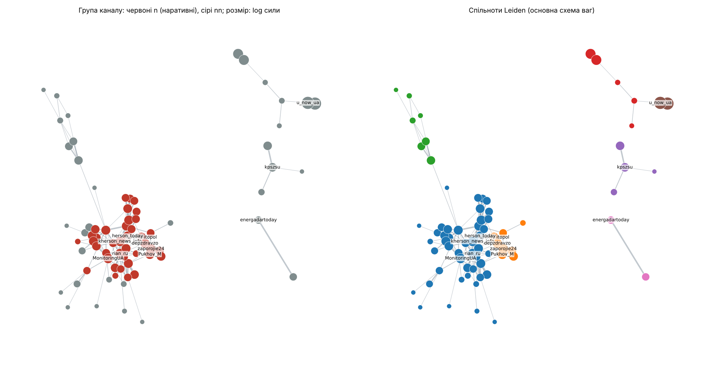

# S3. Мережа каналів за пересиланнями

Джерело чисел: `results/03_network/` (`centrality.csv`, `communities.csv`, `community_summary.csv`, `cross_group.json`, `summary.json`, `checks.json`, `run.json`, `channel_network.gexf` для Gephi, `figures/01_network_map.png`). Запуск 16.11.2026 у хмарній сесії (дані малі, Colab не потрібен), `scripts/s03_network.py` з коміту 811526c, seed 42. Текст звіту збирає `scripts/s03_render_report.py` з тих самих файлів, тому числа тут не можуть розійтися з ними.

## 1. Дані і метод

- Вхід: таблиця `channel_flow_edges` з 214 ребер (знімок графу 11.03.2026), лежить у `data_small/channel_flow_edges.csv`. Вона вручну перенесена з Drive і звірена: збігаються кількість рядків, id і назви каналів з `per_channel.csv`, а відновлений файл збігається з оригіналом за розміром у байтах.
- Вершина це канал, ребро `src` до `dst` означає, що канал `dst` переслав повідомлення каналу `src`, вага це кількість таких повідомлень. Петель і повторів пар немає. Вершин 73 з 111 каналів таблиці (98 мають повідомлення), сума ваг 34 967, найбільша вага 30 810.
- Показники: ступені і сили, PageRank в обидва боки, посередництво (betweenness) за відстанню 1/вага, k-ядро, слабкі компоненти.
- Спільноти: Leiden з функцією якості модулярності, роздільність 1, на неспрямованому графі, де ваги двох напрямків додаються. Десять запусків із seed 42-51, стабільність як попарний NMI між запусками (поріг з плану: більше 0,8). Для чутливості те саме з вагами log(1 + w) і без ваг.
- Групи каналів n (наративні) і nn беру з таблиці каналів (`table_label`): n починається від частки наративних 0,646 серед розмічених повідомлень каналу, nn закінчується на 0,584 (S2). Ці мітки агреговані зі слабких міток повідомлень, тому тут вони лише описують канали, а в ознаки моделей не підуть (висновок S2). Самі ребра від міток не залежать.

## 2. Перевірки

Пройдено 9 з 9 (7 жорстких).

| Перевірка | Пройдено | Тип | Значення |
|---|---|---|---|
| Усі вершини графа є в таблиці каналів | так | жорстка | 73 вершин |
| Ваги ребер додатні цілі | так | жорстка | min 1, max 30810 |
| Сума in-сил = сума out-сил = сума ваг | так | жорстка | in 34967, out 34967, ваги 34967 |
| PageRank сумується в 1 | так | жорстка | 1,000000 і 1,000000 |
| Кожна вершина має спільноту, спільнот більше однієї | так | жорстка | 7 спільнот |
| Стабільність Leiden: мінімальний попарний NMI більший за 0,8 (основна схема ваг) | так | жорстка | mean 1,000, min 1,000, 10 запусків |
| Стабільність Leiden: те саме для log-ваг і незважених | так | м’яка | log min 0,826, none min 1,000 |
| Таблиця ребер збігається з перевіреним перенесенням з Drive (214 рядків, 73 вершини, сума ваг 34 967, максимум 30 810) | так | жорстка | 214 рядків, 73 вершин, сума 34967, максимум 30810 |
| Частка міжгрупових пересилань близька до очікуваних 0,35% з плану (допуск 0,05 в.п.) | так | м’яка | 0,346% |

Очікувані з плану 0,35% міжгрупових пересилань відтворено: 0,346%.

## 3. Структура мережі

- 73 вершини, 214 ребер, 4 слабкі компоненти розміром 60, 7, 4 і 2 канали. Серед вершин 39 каналів групи n і 34 групи nn. З 38 каналів таблиці, яких у мережі немає, 36 належать до nn.
- Одна пара `u_now` до `u_now_ua` несе 30 810 з 34 967 ваги (88,1%). Це два дзеркальні канали з S2. Решта ваги (4 157) розподілена по 213 ребрах.
- 19 каналів ніхто в мережі не пересилає (out-ступінь 0), 11 самі нікого в мережі не пересилають (in-ступінь 0).
- Найвище k-ядро має номер 6, у ньому 15 каналів, усі групи n.

Найсильніші за in-силою (багато пересилають з інших каналів):

| Канал | Група | in-сила | out-сила | in-ступінь | out-ступінь | Спільнота |
|---|---|---|---|---|---|---|
| u_now_ua | nn | 30 811 | 0 | 2 | 0 | 5 |
| suspilnelviv | nn | 712 | 103 | 1 | 1 | 3 |
| MonitoringUA | n | 459 | 0 | 14 | 0 | 0 |
| zaporojie24 | n | 394 | 11 | 9 | 3 | 1 |
| NowMelitopol | n | 334 | 11 | 3 | 4 | 1 |
| herson_today | n | 264 | 33 | 8 | 2 | 0 |
| kherson_news_info | n | 205 | 156 | 11 | 2 | 0 |
| tokmak_segodna | n | 200 | 0 | 15 | 0 | 0 |

Найсильніші за out-силою (їхні повідомлення пересилають інші):

| Канал | Група | in-сила | out-сила | in-ступінь | out-ступінь | Спільнота |
|---|---|---|---|---|---|---|
| u_now | nn | 0 | 30 810 | 0 | 1 | 5 |
| suspilnenews | nn | 103 | 713 | 1 | 2 | 3 |
| rian_ru | n | 0 | 612 | 0 | 17 | 0 |
| depzdravzo | n | 5 | 337 | 2 | 3 | 1 |
| Pukhov_M | n | 12 | 303 | 4 | 4 | 1 |
| hersonruss | n | 17 | 228 | 4 | 12 | 0 |
| readovkanews | n | 4 | 209 | 2 | 15 | 0 |
| kherson_news_info | n | 205 | 156 | 11 | 2 | 0 |

- PageRank джерел (високий у каналів, чиї повідомлення пересилають інші, зокрема ланцюжками): `readovkanews` (0,092), `hersonruss` (0,073), `melitopol_ru` (0,058), `ukr_2025_ru` (0,053), `rezident_ua` (0,048).
- PageRank пересилачів (високий у каналів, що пересилають з активних джерел): `herson_today` (0,104), `kherson_news_info` (0,101), `HersonVestnik` (0,056), `zaporojie24` (0,051), `spletnicca` (0,034).
- Посередництво: `HersonVestnik` (0,028), `zpvestnik` (0,021), `kherson_news_info` (0,019), `ukr_leaks` (0,018), `Pukhov_M` (0,017).

## 4. Спільноти

Основне розбиття (сирі ваги) має 7 спільнот.

| Спільнота | Каналів | з них n | з них nn | Частка ваги всередині | Найсильніші канали |
|---|---|---|---|---|---|
| 0 | 45 | 32 | 13 | 98,7% | rian_ru, MonitoringUA, kherson_news_info |
| 1 | 8 | 7 | 1 | 96,8% | zaporojie24, NowMelitopol, depzdravzo |
| 2 | 7 | 0 | 7 | 98,1% | truexanewsua, truexakyiv, truexakharkiv |
| 3 | 5 | 0 | 5 | 99,9% | suspilnenews, suspilnelviv, hromadske_ua |
| 4 | 4 | 0 | 4 | 100,0% | kpszsu, UkraineNow, Ukrainerada |
| 5 | 2 | 0 | 2 | 100,0% | u_now_ua, u_now |
| 6 | 2 | 0 | 2 | 100,0% | energadartoday, atomgradenergodar |

Стабільність за 10 запусками (45 пар):

| Схема ваг | Спільнот | Модулярність | NMI середній | NMI мінімальний |
|---|---|---|---|---|
| сирі (кількість пересилань, основна) | 7 | 0,305 | 1,000 | 1,000 |
| log(1 + w) | 9/10/11 | 0,526 - 0,539 | 0,930 | 0,826 |
| без ваг (усі 1) | 9 | 0,559 | 1,000 | 1,000 |

- Сирі ваги дають одне й те саме розбиття в усіх запусках, але модулярність низька (0,305), бо 88% ваги в одному ребрі. За log-вагами і без ваг спільнот більше (9/10/11 і 9, модулярність 0,53 - 0,56). Для log-ваг мінімальний NMI 0,83 лише трохи вищий за поріг 0,8. NMI між схемами: сирі з log 0,74, сирі без ваг 0,75, log без ваг 0,95.
- Спільноти не зводяться до міток груп: NMI розбиття з групою n/nn лише 0,28 (log 0,26, без ваг 0,27). Спільнота 0 містить 32 канали n і 13 nn, і 12 з цих 13 nn мають статус `insufficient_data` (мітка за малою кількістю розмічених повідомлень).
- Спільноти 2, 3, 4, 5, 6 складаються лише з каналів nn (серед них пара дзеркал, спільнота 5), каналів n в них немає.

## 5. Пересилання між групами n і nn

Вага пересилань за групами (рядок: група джерела, стовпець: група того, хто переслав):

|  | до n | до nn |
|---|---|---|
| з n | 2 959 | 57 |
| з nn | 64 | 31 887 |

Міжгрупові пересилання: 121 з 34 967, тобто 0,346%.

| Варіант | Усього | Між групами | Частка між групами | Середня за перестановками | 5-й процентиль перестановок | Асортативність r |
|---|---|---|---|---|---|---|
| Основний: сума ваг | 34 967 | 121 | 0,346% | 49,8% | 4,0% | 0,978 |
| Без пари дзеркал | 4 157 | 121 | 2,91% | 50,4% | 29,7% | 0,927 |
| Кількість ребер | 214 | 33 | 15,4% | 50,5% | 43,9% | 0,507 |

- Стійкість. Без пари дзеркал частка зростає до 2,9%, за кількістю ребер до 15,4%, але і це далеко від ~50% для випадкового розподілу міток. Спостережене значення нижче за всі 10 000 перестановок міток між каналами (p не більше 0,0001, це мінімум для такої кількості перестановок). Для варіанта з вагами нуль-розподіл розмитий через одне домінантне ребро, тому надійніші два нижні рядки таблиці.
- Лише для каналів зі статусом `labeled` (мітка за 52 і більше розміченими повідомленнями) міжгрупових пересилань 3 з 34 813 (0,009%). Усі решта 118 одиниць ваги припадають на ребра, один кінець яких належить до 17 nn-каналів зі статусом `insufficient_data`. Тобто мережа майже ідеально розділяє групи, а видимі перетини стосуються каналів з ненадійною міткою.

## 6. Що з цього випливає для S4 і S5

- Мережа майже ідеально розділяє групи n і nn, тому мережева ознака каналу (спільнота, оточення в графі) несе інформацію про його групу, а група агрегована зі слабких міток. Для повідомлень це канальний пріор, а не знання про наратив. У S5 оцінюю моделі з такими ознаками і без них окремо.
- Покриття золотого набору. 305 з 412 золотих повідомлень (74,0%) лежать у 44 з 56 золотих каналів, які є вершинами мережі. Серед наративних таких 140 з 148 (94,6%), серед ненаративних 165 з 264 (62,5%). Отже, сам факт присутності каналу в мережі пов'язаний з класом, і його не можна подавати моделі як ознаку.
- Ваги. Основна (сира) схема має низьку модулярність через одне домінантне ребро. Для ознак кандидати: log(1 + w) або без ваг. Вибір зафіксую в `configs/prereg.md` до оцінювання, сирі ваги залишаю для опису.
- Усі вершини мережі є в таблиці каналів. Семантичний шар (`sem_channel_flow_edges`, 1 273 ребра) сюди не входить, його зроблю в S4 разом з ембедингами.

## 7. Відкриті питання і обмеження

- Сума ваг 34 967 менша за кількість forward-ребер у наборі (35 697, S2) на 730. Причину не з'ясовано (ймовірно, пересилання всередині одного каналу або з каналів поза таблицею). Звірю з `forward_edges.parquet` у Colab на S4. Якщо ці 730 не міжгрупові, частка буде 0,339% (121 з 35 697).
- Вхідну таблицю з 214 ребер перенесено вручну, але звірено за розміром файлу, id і назвами каналів.
- 17 nn-каналів у мережі мають мітку за малою кількістю розмічених повідомлень, їхня група непевна.
- Мережа охоплює 73 з 111 каналів, відсутні 38 (36 з них nn).
