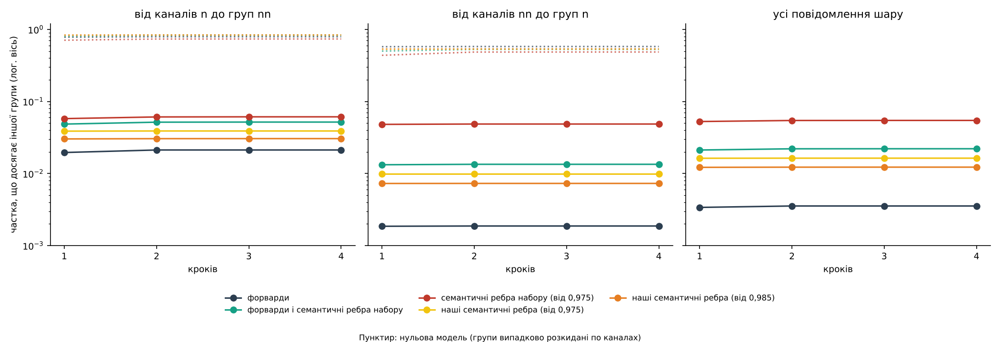
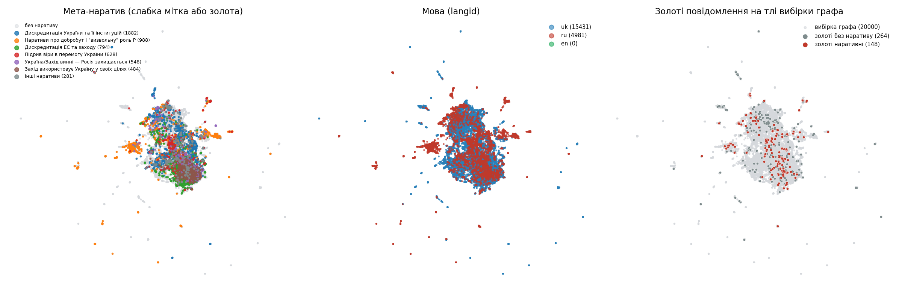
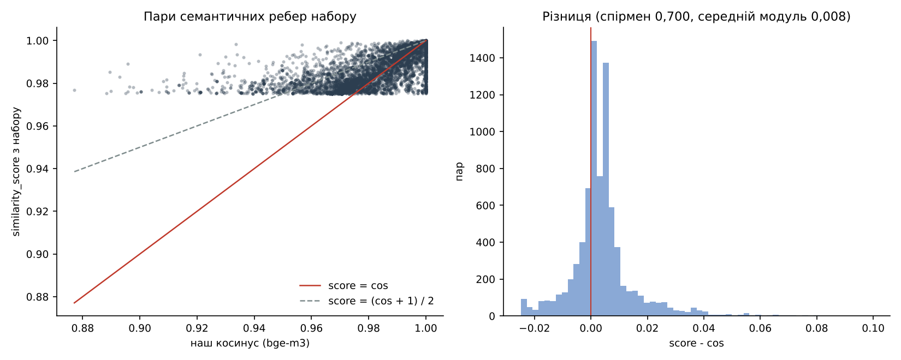

# S4. Семантичний шар

Джерело чисел: `results/04_semantic/` (`summary.json`, `checks.json`, `run.json`, `reachability.csv`, `gold_copies_summary.csv`, `pair_judgement.csv`, `figures/`). Ембединги, пошук сусідів і UMAP рахував Colab на GPU (`colab/04_semantic.ipynb`, код з коміту 33e2963, seed 42, 1 219 с), підсумкові таблиці й перевірки в хмарній сесії. Текст звіту збирає `scripts/s04_render_report.py`.

Файли плану названо інакше: `summary.json` це `edges_stats.json`, `figures/03_umap.png` це `umap.png`.

## 1. Метод

- Вхід: 108 250 повідомлень: 81 584 слабко розмічених, 412 золотих і кінці семантичних ребер набору (38 593 вузлів). Порожніх текстів немає.
- Енкодер `BAAI/bge-m3` (fp16, 1 024 вимірів, max_len 512). Медіана довжини 80 токенів, p95 256, обрізано 0,50% текстів. Норми векторів одиничні, макс. відхилення 1,2e-07.
- Власні ребра: hnswlib на косинусі, k = 80, пороги 0,95, 0,975, 0,985, 0,99. Повноту hnswlib перевірено точним пошуком на 500 випадкових вузлів: 1,0000 за порога 0,985.

## 2. Перевірки

Пройдено 9 з 10, жорстких 6, з них не пройдено 0. М'яких не пройдено 1.

| Перевірка | Пройдено | Тип | Значення |
|---|---|---|---|
| Усі золоті повідомлення ембедовані, порожніх текстів немає | так | жорстка | 412 золотих, порожніх 0 |
| Ключі набору унікальні | так | жорстка | 108 250 ключів |
| Ембединги скінченні й одиничної довжини (відхилення норми менше 1e-3) | так | жорстка | макс. відхилення 1.19e-07, розмірність 1024 |
| Для 99% і більше семантичних ребер набору є наш косинус (обидва кінці ембедовані) | так | жорстка | без косинуса 0 з 52 414 |
| Повнота hnsw за порогом 0,985 не нижча за 0,98 (500 випадкових вузлів, точний пошук) | так | жорстка | 1.0000 (1593 сусідів) |
| Повнота hnsw за порогом 0,975 не нижча за 0,98 | так | жорстка | 1.0000 (1699 сусідів) |
| Однакові тексти мають косинус не нижчий за 0,995 | так | м'яка | мінімум 1.0000 |
| Оцінки набору збігаються з нашим косинусом за рангами на нетривіальних парах (score < 0,995; спірмен не нижчий за 0,9) | ні | м'яка | спірмен 0.559, пірсон 0.476, пар 40 672, пар з score від 0,995 22.4% |
| Оцінки набору збігаються з нашим косинусом за значенням (середній модуль різниці менший за 0,01) | так | м'яка | усі пари 0.0080, нетривіальні 0.0096 (з відображенням (cos + 1) / 2: 0.0064) |
| Агреговані forward_edges збігаються з channel_flow_edges | так | м'яка | forward 35 697, самопересилань 730, сума без них 34 967, у таблиці 34 967 |

Не пройдена м'яка перевірка описує відтворення оцінок набору за рангами (розділ 3).

## 3. Чи відтворюються оцінки схожості набору

Для 52 414 ребер набору порівняно колонку `similarity_score` з нашим косинусом.

| Підмножина пар | Пірсон | Спірмен | Сер. модуль різниці |
|---|---|---|---|
| усі (52 414) | 0,646 | 0,700 | 0,0080 |
| нетривіальні, оцінка < 0,995 (40 672) | 0,476 | 0,559 | 0,0096 |

Оцінки відтворюються за значенням (середній модуль різниці 0,0080), але не за рангами: 22,4% пар мають оцінку не нижче 0,995, і серед решти кореляція слабка (спірмен 0,559). Отже, набір рахував схожість іншим енкодером чи іншою обробкою тексту, і наші ребра не копія його ребер. Знайдено лише 40,6% ребер набору за порога 0,985, а свої ребра в наборі присутні лише на 10,6%.
Практичний наслідок: у моделях семантичні ребра будуємо власним пошуком, а ребра набору лишаємо для порівняння.

## 4. Власні семантичні ребра

| Поріг | Пар | Вузлів з сусідом | Вузлів із вичерпаним k | Знайдено ребер набору | Своїх ребер у наборі |
|---|---|---|---|---|---|
| 0,95 | 283 670 | 103 965 | 3 251 | 67,5% | 12,5% |
| 0,975 | 232 116 | 96 973 | 2 529 | 53,7% | 12,1% |
| 0,985 | 201 757 | 91 034 | 2 058 | 40,6% | 10,6% |
| 0,99 | 186 988 | 87 284 | 1 850 | 32,9% | 9,2% |

- Ребра набору всі між різними каналами (0,0% внутрішньоканальних). У власних ребрах за порога 0,985 внутрішньоканальних пар 45,8%, за 0,975 43,4%. Імовірно, це серійні повтори в межах одного каналу (не перевіряли). Для моделей це ризик: канал майже визначає мітку (S2). Тому в преєстрації основний шар семантичних ребер містить лише міжканальні пари, а чутливість рахується з усіма (`configs/prereg.md`, п. 6 розділу 10).
- Пар між наративними й ненаративними групами каналів (cross) у власних ребрах 0,32%, у ребрах набору 2,06%.

### Перегляд 50 пар біля порогу

Вимога плану: переглянути 50 випадкових пар біля порогу. Узято 50 пар ребер набору з оцінками 0,975 до 0,985, вердикти виставила Claude за початком текстів (`pair_judgement_README.md`).
Копій (те саме повідомлення чи подія з тими самими фактами) 19 з 50 (38%, 95% ДІ Вілсона 26% до 52%), серійних шаблонів з різними фактами 31. З шаблонів 24 це щоденні повідомлення Запорізького мінздраву про кількість народжених (різні числа), решта серійні зведення (МО РФ, ДТП, обстріли) і оголошення. Висновок: поріг на косинусі добре ловить копії, але разом з ними бере серійні формати, тож «семантичне ребро» не гарантує «той самий наратив чи факт». Для ознак моделей це допустимо (шаблонність сама по собі інформативна). Для виключення витоку ми обираємо консервативно: з навчання йдуть і шаблони, тому межа 0,985 разом зі збігом нормалізованого тексту.

## 5. Копії золотих повідомлень

| Поріг | Золотих | З сусідом | З сусідом у розміченій партії | Повідомлень-сусідів | З них у розміченій партії | Пар | Пар з однаковим текстом |
|---|---|---|---|---|---|---|---|
| 0,950 | 412 | 34 | 18 | 1 439 | 410 | 1 439 | 138 |
| 0,975 | 412 | 26 | 15 | 500 | 96 | 500 | 138 |
| 0,985 | 412 | 25 | 13 | 345 | 42 | 345 | 138 |
| 0,990 | 412 | 23 | 13 | 236 | 42 | 236 | 138 |

За порога 0,985 25 золотих мають близького сусіда, всього 345 повідомлень-сусідів, з них 42 у розміченій партії. Їх (та ще золоті, збіги за текстом) виключає S5: в пулі виключено 52 з 81 584 (`results/05_protocol/summary.json`). Виключення мале, тобто золоті майже не мають копій у навчальній партії, але перевірка потрібна саме для цього.

## 6. Досяжність між групами каналів

Частка повідомлень, з яких за 3 кроки по ребрах можна дійти до повідомлення каналу іншої групи (n наративні, nn ненаративні, групи за `table_label` з S3). Нульова модель: 20 перемішувань міток груп між каналами із збереженням розмірів груп.

| Шар | Напрям | Досягають іншої групи | Нульова модель, середнє [p05; p95] |
|---|---|---|---|
| форварди | n до nn | 129 з 6 087 (2,12%) | 79,0% [38,0%; 98,5%] |
| форварди | nn до n | 120 з 64 267 (0,19%) | 57,8% [2,1%; 92,5%] |
| форварди | усі | 249 з 70 354 (0,35%) | н/д |
| семантичні ребра набору | n до nn | 1 115 з 18 233 (6,12%) | 73,6% [59,0%; 88,5%] |
| семантичні ребра набору | nn до n | 989 з 20 360 (4,86%) | 48,5% [36,5%; 55,3%] |
| семантичні ребра набору | усі | 2 104 з 38 593 (5,45%) | н/д |
| власні семантичні, 0,985 | n до nn | 594 з 19 488 (3,05%) | 83,7% [61,3%; 95,5%] |
| власні семантичні, 0,985 | nn до n | 521 з 71 548 (0,73%) | 53,7% [10,8%; 82,3%] |
| власні семантичні, 0,985 | усі | 1 115 з 91 036 (1,22%) | н/д |
| власні семантичні, 0,975 | n до nn | 841 з 21 623 (3,89%) | 83,5% [63,2%; 95,3%] |
| власні семантичні, 0,975 | nn до n | 741 з 75 352 (0,98%) | 53,2% [12,8%; 79,9%] |
| власні семантичні, 0,975 | усі | 1 582 з 96 975 (1,63%) | н/д |
| форварди + семантика набору | n до nn | 1 250 з 24 174 (5,17%) | 82,8% [62,0%; 95,4%] |
| форварди + семантика набору | nn до n | 1 113 з 82 988 (1,34%) | 52,7% [14,8%; 77,9%] |
| форварди + семантика набору | усі | 2 363 з 107 162 (2,21%) | н/д |

- Спостережена досяжність набагато нижча за нульову модель: для форвардів n до nn 2,12% проти 79,0% (p05 38,0%). Групи в мережі розділені сильніше, ніж за випадкового розподілу міток, що узгоджується з 0,346% міжгрупових форвардів у S3.
- Досяжність насичується за 1 до 2 кроки: для семантичних ребер набору (усі) 5,26% за 1 крок, 5,44% за 2, 5,45% за 3 і 5,45% за 4.
- Значення приблизно 0,54 за 3 кроки з плану не відтворено: найближче 5,45% (семантика набору, усі напрями). Невідомо, як рахувалася та цифра в плані, тому порівнювати прямо не варто.

## 7. Узгодження кількості форвардів

У таблиці форвардів 35 697 ребер, з них 730 самопересилань (канал пересилає сам себе). Без них сума ваг 34 967, і вона збігається з сумою ваг `channel_flow_edges` у S3 (34 967) пара за парою. Тобто розбіжність у 730 пояснена самопересиланнями.

## 8. UMAP

UMAP по 20 412 точках (20 000 з графа і 412 золотих).

Зліва за мета-наративом, у центрі за мовою, справа золоті на тлі вибірки. Мета-наративи в основній масі сильно перекриваються, окремі компактні острівці дає лише частина класів (зокрема «визвольна» роль Росії). Російська і українська мови в основній масі змішані, тобто bge-m3 тримає їх у спільному просторі, а походження окремих острівців ru-текстів не перевіряли. Золоті наративні повідомлення розкидані по всій хмарі, а не в окремій області. Це розвідувальна картинка без числової оцінки.

## 9. Обмеження і що далі

- Цифри в розділах 3 і 6 описові. Вони не доводять, що наші ребра кращі за ребра набору, лише що вони інші.
- Вердикти по 50 парах належать одній оцінювачці й тільки за початком текстів.
- Групи n і nn агреговані зі слабких міток, тож досяжність описує мережу каналів, а не наративи як такі.
- Далі: S6 (ембединги bge-m3 з S4 плюс LogReg, дотренування XLM-R за P1) і S7 (ознаки з ребер, де основний шар семантики міжканальний).
