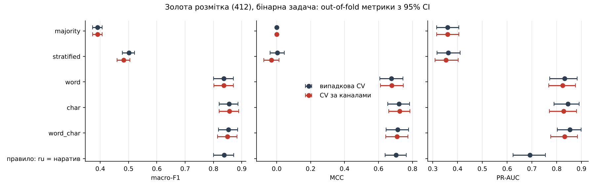

# Етап S6 (cloud). TF-IDF бейзлайн на золотій розмітці

Скрипт `scripts/s06_tfidf.py`, результати в `results/06_text/`. Дані: 412 золотих повідомлень
(148 наративних, 35,9%), 56 каналів. Усі числа нижче з файлів у `results/06_text/`.

## 1. Протокол

- Ознаки: TF-IDF слів (1-2 грами), символьних n-грам (`char_wb`, 2-5), їх об'єднання (`word_char`). Класифікатор: логістична регресія
  з `class_weight=balanced`; C ∈ {0,1; 1; 10; 100} обирається вкладеною 3-кратною CV лише на навчальній частині фолду.
- Оцінка: прогнози out-of-fold. Основне налаштування `random_cv`: стратифікована 5-кратна CV, 5 повторів з різними розбиттями.
  Налаштування `channel_cv`: те саме, але повідомлення одного каналу не потрапляють одночасно в train і test
  (`StratifiedGroupKFold`). Це перевірка на витік стилю каналу, близька за духом до протоколу P3.
- Точкова оцінка: середнє метрики по 5 повторах. 95% CI: процентильний бутстреп по повідомленнях (1000 вибірок),
  метрика на кожній вибірці усереднюється по повторах. Поріг класифікації 0,5.
- Дамі-моделі: `majority` (завжди «без наративу») і `stratified` (випадково за частотою класів) в тій самій схемі CV.
- Додатково: перевірка мовного шорткату (розділ 5) і метрики всередині мовних груп.
- Розподіл на явні і неявні наративи поки недоступний: потрібна розмітка з етапу S5.

## 2. Бінарна задача (наратив / без наративу), випадкова CV

| Модель | macro-F1 | MCC | PR-AUC | F1 «наратив» | precision | recall | σ між повторами (macro-F1) |
|---|---|---|---|---|---|---|---|
| majority | 0,391 [0,373; 0,406] | 0,000 [0,000; 0,000] | 0,359 [0,316; 0,405] | 0,000 [0,000; 0,000] | 0,000 [0,000; 0,000] | 0,000 [0,000; 0,000] | 0,000 |
| stratified | 0,501 [0,478; 0,521] | 0,005 [-0,039; 0,045] | 0,362 [0,317; 0,410] | 0,351 [0,310; 0,386] | 0,363 [0,308; 0,418] | 0,343 [0,308; 0,376] | 0,037 |
| word | 0,836 [0,801; 0,871] | 0,677 [0,609; 0,744] | 0,831 [0,772; 0,882] | 0,798 [0,748; 0,843] | 0,754 [0,690; 0,814] | 0,847 [0,797; 0,897] | 0,001 |
| char | 0,855 [0,820; 0,887] | 0,721 [0,654; 0,782] | 0,845 [0,790; 0,890] | 0,825 [0,778; 0,868] | 0,756 [0,693; 0,819] | 0,908 [0,862; 0,949] | 0,004 |
| word_char | 0,853 [0,817; 0,886] | 0,714 [0,645; 0,777] | 0,853 [0,803; 0,898] | 0,821 [0,773; 0,865] | 0,760 [0,696; 0,821] | 0,892 [0,841; 0,935] | 0,008 |

## 3. Бінарна задача, CV за каналами

| Модель | macro-F1 | MCC | PR-AUC | F1 «наратив» | precision | recall | σ між повторами (macro-F1) |
|---|---|---|---|---|---|---|---|
| majority | 0,391 [0,373; 0,406] | 0,000 [0,000; 0,000] | 0,359 [0,316; 0,405] | 0,000 [0,000; 0,000] | 0,000 [0,000; 0,000] | 0,000 [0,000; 0,000] | 0,000 |
| stratified | 0,483 [0,460; 0,505] | -0,032 [-0,076; 0,013] | 0,352 [0,309; 0,402] | 0,327 [0,291; 0,364] | 0,339 [0,288; 0,391] | 0,319 [0,287; 0,355] | 0,008 |
| word | 0,836 [0,801; 0,871] | 0,678 [0,612; 0,747] | 0,824 [0,768; 0,876] | 0,799 [0,754; 0,843] | 0,746 [0,683; 0,807] | 0,861 [0,812; 0,908] | 0,008 |
| char | 0,856 [0,820; 0,889] | 0,724 [0,659; 0,784] | 0,828 [0,771; 0,879] | 0,827 [0,781; 0,871] | 0,750 [0,689; 0,814] | 0,922 [0,878; 0,958] | 0,008 |
| word_char | 0,849 [0,814; 0,883] | 0,709 [0,643; 0,773] | 0,832 [0,776; 0,884] | 0,818 [0,773; 0,861] | 0,748 [0,687; 0,809] | 0,904 [0,859; 0,943] | 0,006 |

## 4. Парні порівняння (випадкова CV, парний бутстреп)

| A | B | метрика | Різниця [95% CI] |
|---|---|---|---|
| word_char | word | macro_f1 | 0,017 [0,003; 0,030] |
| word_char | word | mcc | 0,037 [0,009; 0,065] |
| word_char | word | pr_auc | 0,022 [0,001; 0,044] |
| word_char | char | macro_f1 | -0,002 [-0,012; 0,007] |
| word_char | char | mcc | -0,007 [-0,028; 0,012] |
| word_char | char | pr_auc | 0,008 [-0,005; 0,024] |
| word | char | macro_f1 | -0,019 [-0,036; -0,002] |
| word | char | mcc | -0,044 [-0,079; -0,010] |
| word | char | pr_auc | -0,014 [-0,043; 0,015] |
| word_char | majority | macro_f1 | 0,463 [0,419; 0,504] |
| word_char | majority | mcc | 0,714 [0,645; 0,777] |
| word_char | majority | pr_auc | 0,494 [0,446; 0,542] |
| word_char | stratified | macro_f1 | 0,352 [0,311; 0,393] |
| word_char | stratified | mcc | 0,709 [0,631; 0,789] |
| word_char | stratified | pr_auc | 0,491 [0,441; 0,538] |

## 5. Перевірка мовного шорткату (важливо)

Топ-слова моделі (`results/06_text/top_words.csv`) для класу «наратив» здебільшого російські, для «без наративу»
українські. Мову визначено через `langid` (uk / ru / en), це евристика, на коротких текстах можливі помилки.

| Мова | без наративу | наратив | разом | частка наративних |
|---|---|---|---|---|
| ru | 58 | 141 | 199 | 70,9% |
| uk | 206 | 7 | 213 | 3,3% |

Правило без жодного навчання «російська мова дорівнює наратив» дає:

| Правило | macro-F1 | MCC | PR-AUC | F1 «наратив» | precision | recall |
|---|---|---|---|---|---|---|
| ru => наратив | 0,838 [0,800; 0,872] | 0,704 [0,639; 0,763] | 0,692 [0,624; 0,754] | 0,813 [0,762; 0,854] | 0,709 [0,645; 0,772] | 0,953 [0,915; 0,985] |

Різниця `word_char` мінус це правило (парний бутстреп): macro-F1 0,015 [-0,006; 0,037], MCC 0,010 [-0,032; 0,049]. Для обох метрик інтервал містить 0, тобто статистично відрізнити TF-IDF від мовного правила за цими даними не вдається.

Якість `word_char` і `char` усередині мовних груп (випадкова CV, ті самі out-of-fold прогнози):

| Група | Модель | n | наративних | macro-F1 | MCC | PR-AUC | F1 «наратив» |
|---|---|---|---|---|---|---|---|
| ru | word | 199 | 141 | 0,601 [0,537; 0,665] | 0,234 [0,104; 0,366] | 0,855 [0,802; 0,904] | 0,817 [0,771; 0,859] |
| ru | char | 199 | 141 | 0,605 [0,533; 0,678] | 0,303 [0,181; 0,432] | 0,867 [0,819; 0,912] | 0,843 [0,801; 0,882] |
| ru | word_char | 199 | 141 | 0,616 [0,547; 0,682] | 0,298 [0,165; 0,427] | 0,874 [0,827; 0,917] | 0,839 [0,797; 0,878] |
| uk | word | 213 | 7 | 0,491 [0,484; 0,496] | -0,008 [-0,015; 0,000] | 0,062 [0,030; 0,143] | 0,000 [0,000; 0,000] |
| uk | char | 213 | 7 | 0,492 [0,486; 0,498] | 0,000 [0,000; 0,000] | 0,042 [0,020; 0,098] | 0,000 [0,000; 0,000] |
| uk | word_char | 213 | 7 | 0,492 [0,486; 0,498] | 0,000 [0,000; 0,000] | 0,056 [0,028; 0,128] | 0,000 [0,000; 0,000] |

У російськомовній групі (199 повідомлень, 141 наративних) `word_char` має macro-F1 0,616 і MCC 0,298, тобто значно нижче загальних цифр. В україномовній групі лише 7 наративних із 213, метрики там мало інформативні.

## 6. Багатокласова задача (6 класів: без наративу, 4 найбільші мета-наративи, інший наратив)

| Модель | macro-F1 | MCC | accuracy |
|---|---|---|---|
| majority | 0,130 [0,124; 0,135] | 0,000 [0,000; 0,000] | 0,641 [0,595; 0,684] |
| stratified | 0,168 [0,154; 0,181] | 0,022 [-0,002; 0,045] | 0,472 [0,440; 0,503] |
| word | 0,389 [0,339; 0,435] | 0,452 [0,391; 0,511] | 0,685 [0,641; 0,727] |
| char | 0,414 [0,366; 0,457] | 0,510 [0,451; 0,567] | 0,721 [0,680; 0,761] |
| word_char | 0,398 [0,351; 0,441] | 0,484 [0,425; 0,541] | 0,704 [0,662; 0,745] |

Класи рахуються за `General label (level-1)`: «без наративу» і чотири найбільші мета-наративи за частотою, решта
об'єднані в «інший наратив» (14 повідомлень). Показано `random_cv`.

Поклассові F1 для `word_char`:

| Клас | n | F1 (word_char) [95% CI] |
|---|---|---|
| Не містить наративу | 264 | 0,885 [0,854; 0,910] |
| Дискредитація України та її інституцій | 48 | 0,418 [0,315; 0,509] |
| Наративи про добробут і "визвольну" роль Росії | 38 | 0,529 [0,403; 0,642] |
| Дискредитація ЕС та заходу | 30 | 0,405 [0,264; 0,531] |
| Підрив віри в перемогу України | 18 | 0,150 [0,000; 0,300] |
| інший наратив | 14 | 0,000 [0,000; 0,000] |

## 7. Перевірки

- ✅ word: macro-F1 вище за верхню межу CI обох дамі-моделей (random_cv): 0,836 проти 0,521
- ✅ char: macro-F1 вище за верхню межу CI обох дамі-моделей (random_cv): 0,855 проти 0,521
- ✅ word_char: macro-F1 вище за верхню межу CI обох дамі-моделей (random_cv): 0,853 проти 0,521
- ✅ word_char не гірша за word за macro-F1 (CI різниці не лежить повністю нижче 0): Δ = 0,017 [0,003; 0,030]
- ✅ перемішані мітки: |MCC| < 0,1: середній MCC = 0,045
- ✅ перемішані мітки: PR-AUC близька до частки позитивних (< частка + 0,05): 0,402 проти частки 0,359
- ✅ перемішані мітки: macro-F1 у межах 0,40-0,60: 0,516
- ✅ мажоритарний клас: macro-F1 ≈ 0,39 (за планом): 0,391

Найсильніші слова (описова перевірка змісту, модель на всіх 412, не оцінка якості) у `results/06_text/top_words.csv`.

**Статус: усі автоматичні перевірки пройдені.**

## 8. Висновки

Числа нижче звірені вручну з таблицями розділів 2, 3, 5 і 6 цього звіту (дата: 16.11.2026). Якщо скрипт перезапускатиметься
з іншими параметрами, цей розділ треба перевірити.

1. **Перше число роботи.** `word_char` на 412 золотих, випадкова CV: macro-F1 0,853 [0,817; 0,886], MCC 0,714 [0,645; 0,777],
   PR-AUC 0,853 [0,803; 0,898]. CV за каналами майже не змінює результат (macro-F1 0,849 [0,814; 0,883]), отже стиль окремих каналів
   результат не пояснює.
2. **Але ця цифра значною мірою відображає мову, а не зміст наративу.** У золотій вибірці 70,9% російськомовних повідомлень
   наративні і лише 3,3% україномовних. Правило без навчання «російська мова = наратив» дає macro-F1 0,838 [0,800; 0,872] і
   MCC 0,704 [0,639; 0,763]. Різниця з `word_char` статистично нерозрізнена (macro-F1 0,015 [-0,006; 0,037], MCC 0,010 [-0,032; 0,049]).
3. **Усередині російськомовних повідомлень** (199, з них 141 наративних) `word_char` дає macro-F1 0,616 [0,547; 0,682] і
   MCC 0,298 [0,165; 0,427]. PR-AUC 0,874 [0,827; 0,917] вищий за частку наративних у цій групі (141 з 199, тобто 0,709), отже
   певний сигнал понад мову є, але він набагато слабший за загальну цифру. В україномовній групі 7 наративних із 213, жодне
   модель не знаходить (F1 класу «наратив» 0,000).
4. **Багатокласова задача:** `word_char` macro-F1 0,398 [0,351; 0,441]. Надійно розпізнається лише клас «без наративу»
   (F1 0,885); «Підрив віри в перемогу» (F1 0,150) та «інший наратив» (F1 0,000) практично не розпізнаються.
5. **Наслідки для плану (потрібне ваше рішення на S5):**
   - Основну оцінку H1-H3 робити в російськомовному зрізі, а загальну цифру завжди подавати поряд з мовним правилом як нижньою межею.
   - Гібрид порівнювати не лише з TF-IDF, а й з мовним правилом. Графові ознаки каналу (частка наративних постів, спільнота) можуть
     стати таким самим шорткатом, бо канал визначає і мову, і мітку. У протоколах P1-P3 це треба перевіряти всередині мов.
   - Україномовних наративних прикладів у золотій вибірці майже немає, тому висновки про україномовні наративи за цими даними
     зробити не можна. Це або обмеження в тексті, або додаткова розмітка.
6. **Обмеження.** Мова визначена евристично (`langid`), на коротких текстах можливі помилки. 412 повідомлень, інтервали широкі.
   Порівняння з метриками оригінальних моделей непряме: вони оцінені на слабких мітках, до того ж їхній `general_f1` є accuracy.

