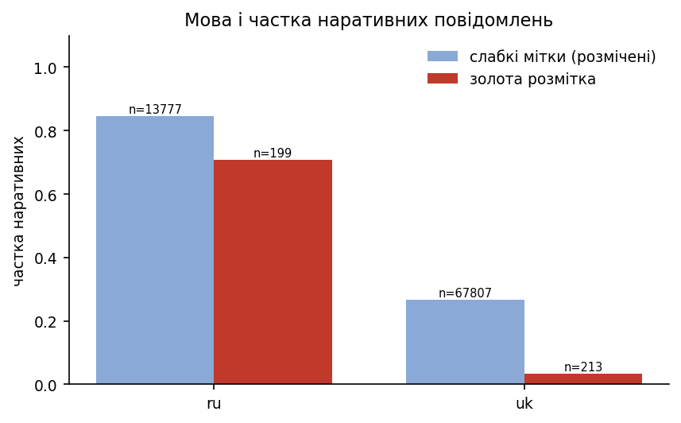
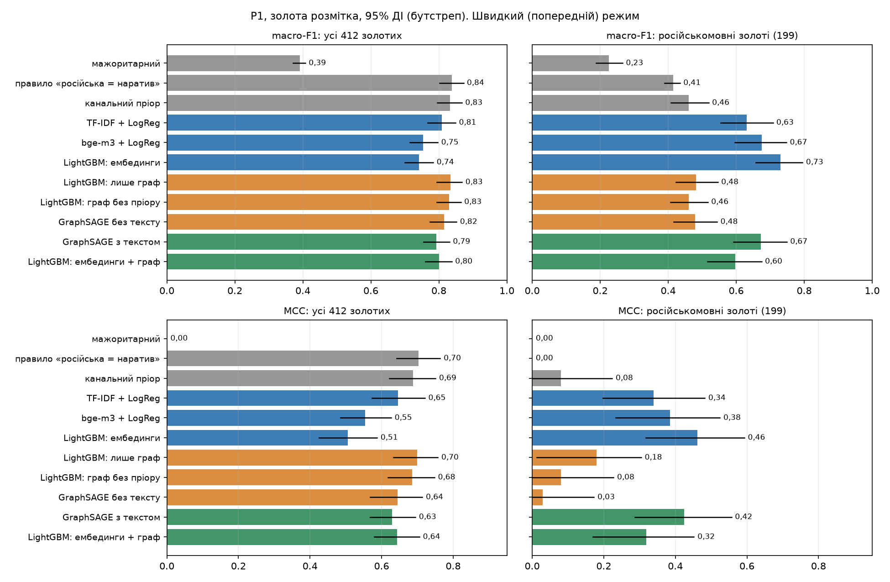
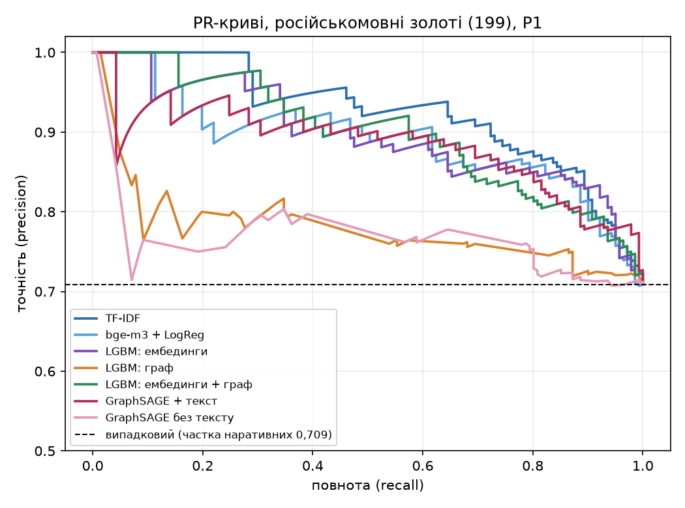
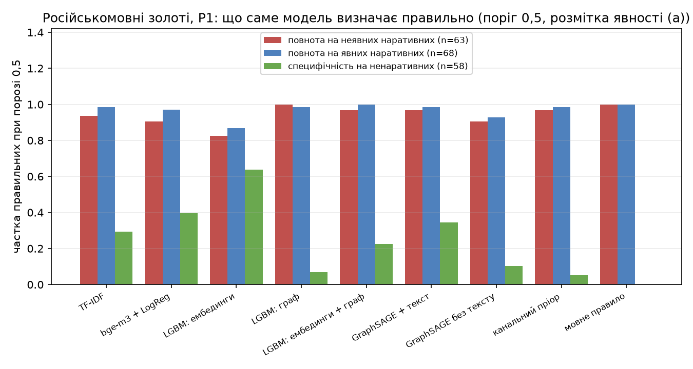
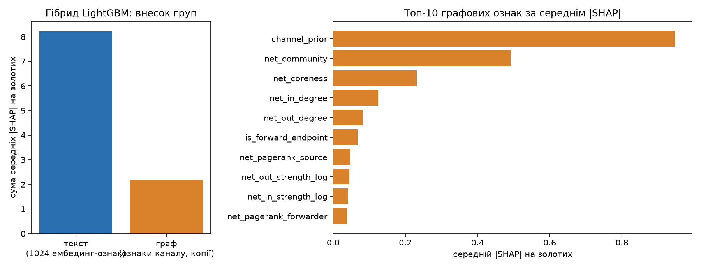
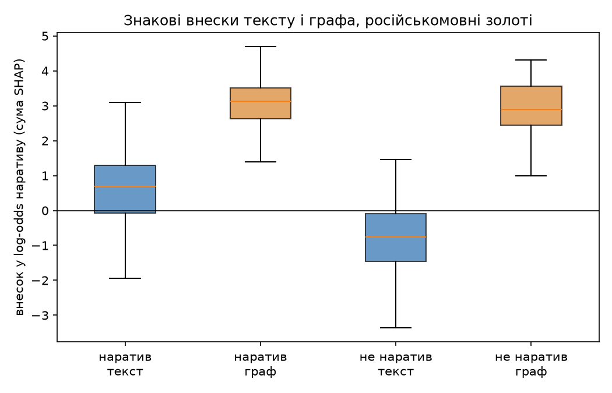
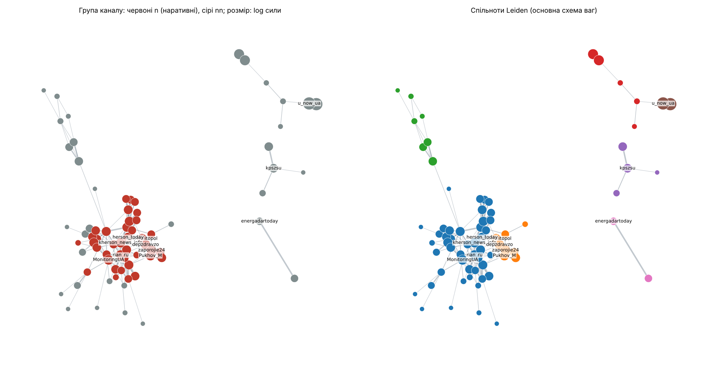
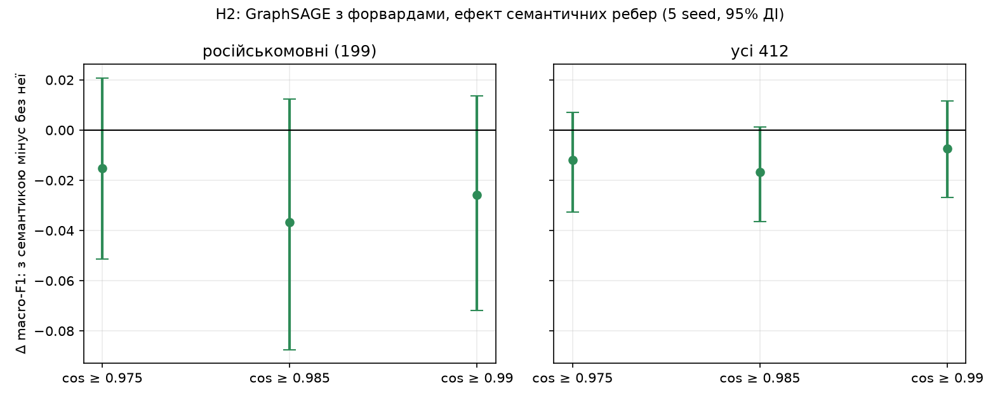

# Попередній звіт: гібридні моделі граф + текст на золотих повідомленнях

Дата: 23.11.2026. Режим: **швидкий (попередній)**, для презентації та чернетки розділів 3 і 4. Це не підсумкові результати: у розділі 7 перелічено, чим цей режим слабший за преєстрований у `configs/prereg.md`. Усі числа взято з файлів у `results/` (список джерел у розділі 10), скрипти перелічені там само.

## 1. Що перевіряється і де це в дипломі

Тема: гібридні моделі на основі графової топології та семантики тексту для виявлення дезінформаційних наративів. Основне питання: чи допомагає графова структура (мережа каналів, семантичні копії, пересилання) там, де сам текст не вистачає, зокрема на **неявних** наративах (гіпотеза H1), і чи дають семантичні ребра інформацію понад пересилання (H2).

| Розділ диплома | Що цей звіт дає |
|---|---|
| Дані і протокол | розділ 2 нижче |
| Методи (графові ознаки, LightGBM, GNN) | розділ 3 |
| Результати та порівняння з бейзлайнами | розділи 4 і 5 |
| Перевірка на витік, контролі | розділ 6 |
| Гіпотези H1, H2, H3 | розділ 8 |
| Обмеження | розділ 7 |

## 2. Дані і протокол оцінювання

- Оцінка лише на **золотій розмітці**: 412 повідомлень, 148 наративних, 56 каналів. Слабкі (LLM) мітки лише для навчання і валідації.
- Навчальний пул P1: 81 532 повідомлення зі слабкими мітками без золотих, без їхніх точних дублікатів і без семантичних копій (cos ≥ 0,985). P2 (часовий): навчання 53 664 повідомлення до 2025-09-01, тест 116 золотих.
- **Російськомовний зріз** (199 золотих, з них 141 наративне) основний за преєстрацією, бо мова майже визначає мітку: наративні 70,9% російськомовних і 3,3% україномовних золотих. Правило «російська = наратив» без жодного навчання дає на всіх 412 macro-F1 0,838. Тому загальні цифри завжди подаються поряд із цим правилом.
- Метрики: macro-F1, MCC, PR-AUC із 95% ДІ (бутстреп по повідомленнях, 1000 вибірок, поріг 0,5 заздалегідь).
- Неявні наративи: розмітка (а), виконана LLM за рубрикатором (63 неявних і 68 явних у російськомовному зрізі). Зовнішньої перевірки розмітки ще немає.



*Рис. 1. Склад вибірки за мовою (з S2). Мовний зсув у золотих є головним джерелом шорткатів.*

## 3. Що зроблено

| Етап | Модель / метод | Що саме |
|---|---|---|
| S6 | TF-IDF + LogReg | слова 1-2 і символьні n-грами, навчання на пулі слабких міток, C за валідацією |
| S6 | bge-m3 + LogReg | ембединги bge-m3 (108 250 повідомлень, 1024 виміри, fp16), C за валідацією |
| S7 | LightGBM на графових ознаках | ознаки каналу з мережі (log(1+w)): ступені, сили, PageRank, k-core, спільнота Leiden; семантичні копії між каналами (cos ≥ 0,985, точний пошук на GPU): кількість копій, кількість каналів-копій, найбільший cos, час до першої копії; прапорець «кінець форварда»; канальний пріор лише з train (позафолдово) |
| S7 | LightGBM на ембедингах | 1024 ознаки bge-m3 |
| S7 | LightGBM на обох | 1040 ознак |
| S8 | GraphSAGE на гетерографі | вузли: повідомлення (108 250) і канали (97); ребра: семантичні між каналами (128 480 пар), «канал публікує повідомлення»; варіанти з текстом bge-m3 і без тексту |
| S12 | Прототип Streamlit | вибір повідомлення, ймовірності текстової, графової і гібридної моделей, внесок тексту і графа (SHAP), 5 найсхожіших повідомлень |

Гіперпараметри LightGBM: Optuna за валідацією слабких міток (поріг 0,5), не за золотими. «Найкраща текстова» і «найкраща гібридна» визначаються лише за валідаційним macro-F1 слабких міток: найкраща текстова це TF-IDF (0,826), гібридна LightGBM на обох наборах ознак (0,828).

## 4. Основні результати (P1)

Російськомовний зріз (основний), 199 повідомлень:

| Модель | macro-F1 | MCC | PR-AUC |
|---|---|---|---|
| мажоритарний | 0,226 [0,19; 0,27] | 0,000 | 0,709 |
| правило «російська = наратив» | 0,415 [0,39; 0,43] | 0,000 | 0,709 |
| канальний пріор | 0,460 [0,41; 0,52] | 0,081 [-0,08; 0,22] | 0,766 |
| TF-IDF + LogReg | 0,631 [0,55; 0,71] | 0,340 [0,20; 0,48] | 0,925 [0,88; 0,96] |
| bge-m3 + LogReg | 0,675 [0,60; 0,75] | 0,385 [0,23; 0,52] | 0,891 |
| LightGBM: ембединги | **0,730** [0,66; 0,80] | **0,461** [0,32; 0,59] | 0,897 |
| LightGBM: лише граф | 0,481 [0,42; 0,55] | 0,180 [0,01; 0,30] | 0,773 |
| GraphSAGE без тексту | 0,480 [0,42; 0,54] | 0,029 [-0,11; 0,17] | 0,760 |
| GraphSAGE з текстом | 0,673 [0,59; 0,75] | 0,424 [0,29; 0,56] | 0,885 |
| LightGBM: ембединги + граф | 0,597 [0,52; 0,67] | 0,318 [0,17; 0,45] | 0,899 |

Усі 412 золотих (вторинний зріз):

| Модель | macro-F1 | MCC | PR-AUC |
|---|---|---|---|
| мажоритарний | 0,391 | 0,000 | 0,359 |
| правило «російська = наратив» | **0,838** [0,80; 0,87] | **0,704** [0,64; 0,76] | 0,692 |
| канальний пріор | 0,833 [0,80; 0,87] | 0,689 [0,62; 0,75] | 0,752 |
| TF-IDF + LogReg | 0,809 [0,77; 0,85] | 0,646 [0,57; 0,72] | 0,864 [0,82; 0,91] |
| bge-m3 + LogReg | 0,754 [0,72; 0,80] | 0,554 [0,48; 0,63] | 0,795 |
| LightGBM: ембединги | 0,741 [0,70; 0,78] | 0,505 [0,43; 0,59] | 0,752 |
| LightGBM: лише граф | 0,834 [0,79; 0,87] | 0,699 [0,63; 0,76] | 0,757 |
| GraphSAGE без тексту | 0,816 [0,77; 0,85] | 0,644 [0,57; 0,71] | 0,730 |
| GraphSAGE з текстом | 0,793 [0,76; 0,83] | 0,629 [0,57; 0,69] | 0,843 |
| LightGBM: ембединги + граф | 0,800 [0,76; 0,84] | 0,643 [0,58; 0,71] | 0,873 [0,82; 0,92] |



*Рис. 2. macro-F1 і MCC на золотих, P1, 95% ДІ. Сірі стовпці: компаратори без навчання або з одним правилом. Сині: текст. Помаранчеві: лише граф. Зелені: гібриди.*

### Що з цього випливає

1. **На всіх 412 золотих жодна навчена модель не перевершує мовне правило** (0,838). Цифра «0,8» без цього компаратора вводить в оману. Моделі, що працюють лише з графовими ознаками, дають 0,83 саме тому, що повторюють «який це канал, а отже яка мова».
2. **У російськомовному зрізі, де мовне правило безсиле (MCC 0,000), працює текст.** Найкращі: LightGBM на ембедингах (MCC 0,461), GraphSAGE з текстом (0,424), bge-m3 + LogReg (0,385). Графові моделі без тексту близькі до нуля (MCC 0,029 для GraphSAGE і 0,180 для LightGBM, дублюють канальний пріор).
3. **Додавання графових ознак до ембедингів не допомагає.** LightGBM «ембединги + граф» мінус LightGBM «ембединги»: macro-F1 −0,133 [−0,225; −0,046] у російськомовному зрізі (гірше) і +0,059 [0,017; 0,103] на всіх 412 (краще, бо граф підказує мову). Це розвідувальний результат, не з підтверджувальних тестів.
4. **GraphSAGE з текстом проти GraphSAGE без тексту:** +0,193 [0,112; 0,277] macro-F1 у російськомовному зрізі. Проти bge-m3 + LogReg (тих самих ембедингів без графа): −0,002 [−0,088; 0,078]. Тобто структура, яку GraphSAGE бачить у швидкому режимі, нічого не додає до тексту.



*Рис. 3. PR-криві у російськомовному зрізі. Пунктир: частка наративних (0,709), рівень випадкового класифікатора. Криві текстових моделей і гібридів лежать вище, графові моделі без тексту близькі до пунктиру.*

## 5. Явні та неявні наративи, помилки на ненаративних



*Рис. 4. Російськомовні золоті. Частка правильних при порозі 0,5: повнота на неявних наративних (63), на явних (68) і специфічність на ненаративних (58).*

- Усі моделі знаходять 83-100% і явних, і неявних наративних. Явність майже не змінює повноти (TF-IDF: 0,937 на неявних проти 0,985 на явних; LightGBM-ембединги: 0,825 проти 0,868).
- Проблема в іншому: **у російськомовному зрізі моделі називають наративними майже всі повідомлення**. Специфічність на 58 ненаративних: TF-IDF 0,293, bge-m3 + LogReg 0,397, GraphSAGE з текстом 0,345, LightGBM-ембединги 0,638 (найкраща), лише граф 0,069, канальний пріор 0,052. Саме тому macro-F1 у цьому зрізі низький, а MCC скромний.
- Імовірна причина: у слабких мітках пулу російськомовні повідомлення переважно наративні (84,5%, S2), і модель вчиться «російська мова, канал, стиль → наратив». Це зміщення мітки навчального пулу, а не недолік конкретної архітектури. Це варто явно записати в обмеженнях розділу 4.

## 6. Внесок тексту і графа (SHAP) та шорткати



*Рис. 5. SHAP гібридного LightGBM на золотих. Ліворуч: сума середніх |SHAP| за групами. Праворуч: топ-10 графових ознак.*



*Рис. 6. Знакові внески тексту і графа в log-odds наративу, російськомовні золоті.*

- **Рис. 6 показує головне:** у російськомовному зрізі внесок графа приблизно +3 у log-odds і для наративних, і для ненаративних повідомлень, тобто граф лише зсуває всі прогнози в бік «наратив» і не розрізняє класи. Внесок тексту має різні знаки: медіана приблизно +0,7 для наративних і приблизно −0,8 для ненаративних. Розрізняє класи саме текст. Це числове підтвердження шорткату: ознаки каналу кодують «російськомовний канал, отже наратив».
- Сума середніх |SHAP| на золотих: текст 8,22, граф 2,17 (групи складаються з різної кількості ознак, тож це не частка «важливості», а порівняння масштабів внеску).
- Найсильніші графові ознаки: `channel_prior`, `net_community`, `net_coreness`, `net_in_degree`: усі це ознаки **каналу**, тобто його ідентичність. Ознаки семантичних копій у топ-10 не потрапили: на золотих копій практично немає (пул P1 свідомо виключає їхні копії), тож цей канал сигналу майже порожній.
- Це узгоджується з S3: 88,1% ваги мережі несе одна пара каналів-дзеркал, присутність каналу в мережі пов'язана з класом, спільноти Leiden не збігаються з групами наративних каналів (NMI 0,28).



*Рис. 7. Мережа каналів (S3): 73 вершини, 214 ребер.*

## 7. Контролі, перевірки і обмеження

Негативні контролі з преєстрації (розділ 8):

| Контроль | Результат |
|---|---|
| Перемішані мітки, LightGBM (граф і граф+ембединги) | MCC 0,000, моделі передбачають один клас: пройдено |
| Перемішані мітки, bge-m3 + LogReg | MCC −0,069 [−0,167; 0,025], ДІ включає 0: пройдено |
| Перемішані мітки, TF-IDF | MCC −0,110 [−0,202; −0,018], ДІ **не** включає 0: **не пройдено** формально. Значення мале і від'ємне; ймовірна причина: модель на перемішаних мітках свідомо лягає на мажоритарний клас, який має негативний зв'язок з мовним розподілом тесту. Потребує окремого пояснення до фіналу |
| Перезв'язана мережа каналів і розв'язані ознаки копій | macro-F1 0,799 проти 0,800 (оригінал): мережева частина гібрида майже не впливає на результат |
| MCC суто графової моделі не вище 0,8 | 0,699 і 0,685 (без пріору): поріг витоку не перевищено, але графова модель на 412 по суті повторює мовне правило |

**Обмеження швидкого режиму (чесно):**
- XLM-R **не запускався** у цьому прогоні (код готовий, словникові ембединги заморожено для 6 ГБ VRAM, перевірено на dev). У таблицях замість нього bge-m3 + LogReg і LightGBM на ембедингах.
- LightGBM: 20 спроб Optuna замість 50, пошук на підвибірці 20 тис. рядків, 1 seed, лише P1 і P2 (P3 немає).
- GraphSAGE: у розділах 4-6 ребра семантичні між каналами і «канал публікує повідомлення»; форварди повідомлень додано лише в абляції H2 (розділ 8). co_publication, R-GCN і HGT немає. P2 для GNN не рахувався (щоб не було витоку майбутніх ребер).
- Семантичні копії: точний пошук на GPU замість hnswlib (на Windows не збирається).
- Золота вибірка мала (199 у російськомовному зрізі), ДІ широкі; розмітка явності виконана однією LLM без зовнішньої перевірки.
- Слабкі мітки зміщені за мовою, каналом і часом (S2), тож результати P1 це «навчання на зміщених LLM-мітках, тест на золотих».

## 8. Гіпотези (попередньо, жодна не підтверджена і не відхилена)

- **H1 (гібрид кращий за текст на неявних наративах).** Найкраща гібридна (LightGBM ембединги + граф, за валідацією) проти найкращої текстової (TF-IDF, за валідацією), російськомовний зріз, P1, розмітка (а): різниця macro-F1 на неявних −0,038 [−0,143; 0,060], на явних −0,046 [−0,149; 0,051], різниця різниць +0,007 [−0,019; 0,035]. Нижня межа ДІ не додатна, отже критерій H1 **не виконано** (це не доказ відсутності ефекту, ДІ широкі). Вузький і широкий варіанти розмітки дають той самий висновок. За автоматичним визначенням (б) у російськомовному зрізі неявних лише 13 (менше 30), тож «недостатньо даних». Для P2 неявних лише 11 у російськомовному зрізі: «недостатньо даних».
- **H2 (семантичні ребра додають інформацію понад форварди).** Перевірено в швидкому режимі: GraphSAGE з текстом bge-m3, каналами, форвардами (35 697 між повідомленнями) і семантичними ребрами між каналами (128 480 за порогу 0,985), 5 seed, P1, російськомовний зріз. Різниця macro-F1 «з семантикою мінус без неї» за порогу 0,985: −0,037 [−0,087; 0,012]; за порогів 0,975 і 0,99: −0,015 [−0,051; 0,021] і −0,026 [−0,072; 0,014]. Знак не додатний за жодного порогу, нижня межа ДІ не вища за нуль: критерій H2 **не виконано** (до поправки Холма). Важливо: лише 24 із 412 золотих мають семантичного сусіда (0,985), 12 з них російськомовні, і лише 6 мають форвард (2 російськомовні), тож тест майже не торкається ребер, а ДІ широкі. Файли: `results/quick/08_gnn_h2/` (`h2_diffs.csv`, `h2_per_seed.csv`, `h2_verdict.json`, `gold_edge_coverage.csv`, `figures/h2_diffs.png`), скрипти `scripts/s08_run.py`, `scripts/s08_h2_eval.py`. Не включено co_publication, R-GCN, HGT.



- **H3 (каскади наративних кластерів відрізняються від органічних).** Етап S10 ще не розпочато.

## 9. Прототип (S12)

Streamlit-застосунок `app/streamlit_app.py` на збережених прогнозах (без GPU): вибір повідомлення (за мовою, міткою, лише помилки гібрида), ймовірності наративу від текстової, графової і гібридної моделей, внесок тексту і графа (SHAP), 5 найсхожіших повідомлень набору. Запуск:

```powershell
.venv\Scripts\python.exe -I scripts\s12_prepare.py --hybrid results\quick\07_simple_hybrid --mode "швидкий (попередній)"
.venv\Scripts\python.exe -m streamlit run app\streamlit_app.py
```

## 10. Джерела чисел і відтворення

| Що | Файл | Скрипт |
|---|---|---|
| Метрики з ДІ (P1) | `results/quick/summary/metrics_p1.csv` | `scripts/quick_summary.py` |
| Парні різниці | `results/quick/summary/paired_p1.csv`, `results/quick/07_simple_hybrid/paired_diffs.csv` | `scripts/quick_summary.py`, `scripts/s07_eval.py` |
| H1 (попередньо) | `results/quick/07_simple_hybrid/h1_preliminary.csv` | `scripts/s07_eval.py` |
| Контролі | `results/quick/07_simple_hybrid/checks.json` | `scripts/s07_eval.py` |
| Повнота за явністю, специфічність | `results/quick/summary/recall_explicitness_ru_p1.csv` | `scripts/quick_figures.py` |
| SHAP | `results/quick/07_simple_hybrid/shap_features.csv`, `shap_groups.csv` | `scripts/s07_run.py` |
| Валідація слабких міток | `results/quick/summary/valid_macro_f1_p1.csv` | `scripts/quick_summary.py` |
| Прогнози TF-IDF, bge-m3 + LogReg | `results/06_text_models/` | `scripts/s06_train.py` |
| LightGBM | `results/quick/07_simple_hybrid/` | `scripts/s07_run.py` |
| GraphSAGE | `results/quick/08_gnn/` | `scripts/s08_run.py` |
| H2 (абляція семантичних ребер) | `results/quick/08_gnn_h2/h2_diffs.csv`, `h2_verdict.json` | `scripts/s08_run.py`, `scripts/s08_h2_eval.py` |

Середовище: Windows 11, RTX 3060 Laptop 6 ГБ, Python 3.13, torch 2.11+cu128, PyG 2.8.1, LightGBM 4.7. Час: LightGBM на ембедингах 150 с, на обох наборах 105 с, GraphSAGE 7-16 с на seed.

## 11. Що далі

1. Повний режим S6: XLM-R (3 seed, 3 епохи) і P3 для всіх моделей, разом ≈ 2 години GPU.
2. Додати co_publication, R-GCN і HGT та повторити абляцію H2 з повною моделлю. Архів `parquet` з OSF (269 МБ) уже завантажено, форвард-ребра використано в H2.
3. Повний S7: 50 спроб Optuna, 5 seed, P3, сліпа перевірка розмітки явності.
4. Розібрати формальний провал контролю TF-IDF з перемішаними мітками і зсув у слабких мітках за мовою (додати зважування або навчання усередині мовних груп).
5. Напрям B (S10): кластери і каскади для H3.
