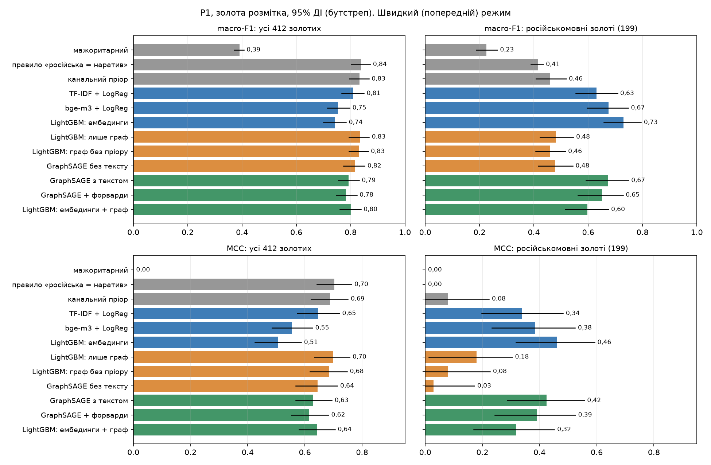

# Швидке зведення S6, S7, S8 (попередній режим для презентації)

Усі числа взято з `results/quick/summary/*.csv` (скрипт `scripts/quick_summary.py`) і прогнозів у `results/`. Це описове зведення: ні модель, ні поріг, ні зріз за золотими не обирались. **Не підсумкові результати**: нижче перелічено, чим цей режим слабший за преєстрований.

## Чим швидкий режим відрізняється від плану

- XLM-R: підвибірка train 20 000 рядків, 1 seed, 2 епохи, словникові ембединги заморожено (повний режим: весь пул, 3 seed, 3 епохи).
- LightGBM: 20 спроб Optuna замість 50, пошук параметрів на підвибірці 20 000 рядків, 1 seed, лише P1 і P2, без P3.
- GraphSAGE: ребра лише семантичні (між каналами, cos ≥ 0,985) і «канал публікує повідомлення»; форвардів на рівні повідомлень і co_publication немає; лише GraphSAGE (без R-GCN і HGT), 3 seed, лише P1.
- Семантичні копії шукаються точним пошуком на GPU (hnswlib на Windows недоступний).
- Преєстровані негативні контролі виконано для LightGBM; для XLM-R контроль із перемішаними мітками у швидкому режимі не запускався.

## Метрики на золотих, P1, 95% ДІ

Макро-F1, MCC, PR-AUC. Перший блок: усі 412 золотих; другий: російськомовні (199), основний зріз за преєстрацією. Приклад читання: «0,731 [0,66; 0,79]».

### Російськомовний зріз (основний)

| Модель | macro-F1 | MCC | PR-AUC |
|---|---|---|---|
| мажоритарний | 0,226 [0,19; 0,27] | 0,000 [0,00; 0,00] | 0,709 [0,64; 0,77] |
| правило «російська = наратив» | 0,415 [0,39; 0,43] | 0,000 [0,00; 0,00] | 0,709 [0,64; 0,77] |
| канальний пріор | 0,460 [0,41; 0,52] | 0,081 [-0,08; 0,22] | 0,766 [0,69; 0,83] |
| TF-IDF + LogReg | 0,631 [0,55; 0,71] | 0,340 [0,20; 0,48] | 0,925 [0,88; 0,96] |
| bge-m3 + LogReg | 0,675 [0,60; 0,75] | 0,385 [0,23; 0,52] | 0,891 [0,84; 0,94] |
| LightGBM: ембединги | 0,730 [0,66; 0,80] | 0,461 [0,32; 0,59] | 0,897 [0,84; 0,94] |
| LightGBM: лише граф | 0,481 [0,42; 0,55] | 0,180 [0,01; 0,30] | 0,773 [0,70; 0,84] |
| LightGBM: граф без пріору | 0,460 [0,41; 0,52] | 0,081 [-0,07; 0,23] | 0,799 [0,72; 0,86] |
| GraphSAGE без тексту | 0,480 [0,42; 0,54] | 0,029 [-0,11; 0,17] | 0,760 [0,68; 0,84] |
| GraphSAGE з текстом | 0,673 [0,59; 0,75] | 0,424 [0,29; 0,56] | 0,885 [0,82; 0,94] |
| GraphSAGE + форварди | 0,651 [0,56; 0,73] | 0,391 [0,24; 0,53] | 0,913 [0,87; 0,95] |
| LightGBM: ембединги + граф | 0,597 [0,52; 0,67] | 0,318 [0,17; 0,45] | 0,899 [0,85; 0,94] |

### Усі 412 золотих (вторинний)

| Модель | macro-F1 | MCC | PR-AUC |
|---|---|---|---|
| мажоритарний | 0,391 [0,37; 0,41] | 0,000 [0,00; 0,00] | 0,359 [0,31; 0,41] |
| правило «російська = наратив» | 0,838 [0,80; 0,87] | 0,704 [0,64; 0,76] | 0,692 [0,63; 0,76] |
| канальний пріор | 0,833 [0,80; 0,87] | 0,689 [0,62; 0,75] | 0,752 [0,68; 0,82] |
| TF-IDF + LogReg | 0,809 [0,77; 0,85] | 0,646 [0,57; 0,72] | 0,864 [0,82; 0,91] |
| bge-m3 + LogReg | 0,754 [0,72; 0,80] | 0,554 [0,48; 0,63] | 0,795 [0,73; 0,85] |
| LightGBM: ембединги | 0,741 [0,70; 0,78] | 0,505 [0,43; 0,59] | 0,752 [0,68; 0,81] |
| LightGBM: лише граф | 0,834 [0,79; 0,87] | 0,699 [0,63; 0,76] | 0,757 [0,68; 0,83] |
| LightGBM: граф без пріору | 0,830 [0,79; 0,86] | 0,685 [0,62; 0,75] | 0,773 [0,71; 0,84] |
| GraphSAGE без тексту | 0,816 [0,77; 0,85] | 0,644 [0,57; 0,71] | 0,730 [0,65; 0,81] |
| GraphSAGE з текстом | 0,793 [0,76; 0,83] | 0,629 [0,57; 0,69] | 0,843 [0,78; 0,90] |
| GraphSAGE + форварди | 0,784 [0,75; 0,82] | 0,615 [0,55; 0,68] | 0,879 [0,83; 0,92] |
| LightGBM: ембединги + граф | 0,800 [0,76; 0,84] | 0,643 [0,58; 0,71] | 0,873 [0,82; 0,92] |

## Парні різниці (P1, парний бутстреп)

| A мінус B | зріз | різниця macro-F1 | 95% ДІ |
|---|---|---|---|
| lgbm_both мінус lgbm_emb | all | 0,059 | [0,017; 0,103] |
| lgbm_both мінус lgbm_emb | ru | -0,133 | [-0,225; -0,046] |
| lgbm_both мінус tfidf | all | -0,008 | [-0,039; 0,023] |
| lgbm_both мінус tfidf | ru | -0,034 | [-0,129; 0,060] |
| lgbm_emb мінус tfidf | all | -0,068 | [-0,117; -0,022] |
| lgbm_emb мінус tfidf | ru | 0,099 | [0,012; 0,184] |
| gnn_sage мінус gnn_sage_notext | all | -0,023 | [-0,060; 0,015] |
| gnn_sage мінус gnn_sage_notext | ru | 0,193 | [0,112; 0,277] |
| gnn_sage мінус bge_lr | all | 0,039 | [0,003; 0,075] |
| gnn_sage мінус bge_lr | ru | -0,002 | [-0,088; 0,078] |
| lgbm_graph мінус channel_prior | all | 0,001 | [-0,014; 0,016] |
| lgbm_graph мінус channel_prior | ru | 0,021 | [0,000; 0,058] |

## Валідаційний macro-F1 на слабких мітках (за ним обирають моделі, не за золотими)

| Модель | valid macro-F1 |
|---|---|
| h2_sem985 | 0,8327 |
| h2_sem975 | 0,8326 |
| h2_sem990 | 0,8320 |
| h2_nosem | 0,8312 |
| h2_nofwd | 0,8309 |
| lgbm_both_rewired | 0,8297 |
| gnn_sage | 0,8296 |
| lgbm_both | 0,8285 |
| tfidf | 0,8259 |
| lgbm_emb | 0,8087 |
| bge_lr | 0,7841 |
| lgbm_graph | 0,7030 |
| lgbm_graph_noprior | 0,7014 |
| gnn_sage_notext | 0,7002 |
| bge_lr_shuf | 0,5048 |
| tfidf_shuf | 0,4999 |
| lgbm_both_shuf | 0,3892 |
| lgbm_graph_shuf | 0,3892 |
